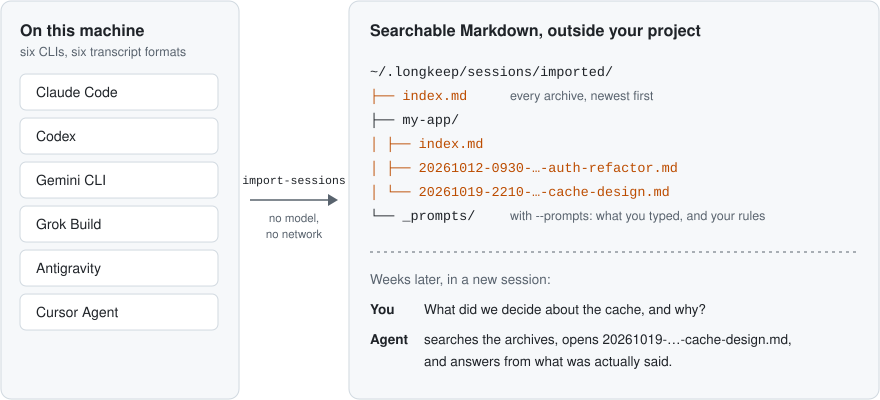
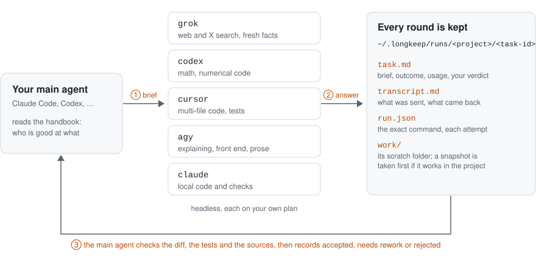
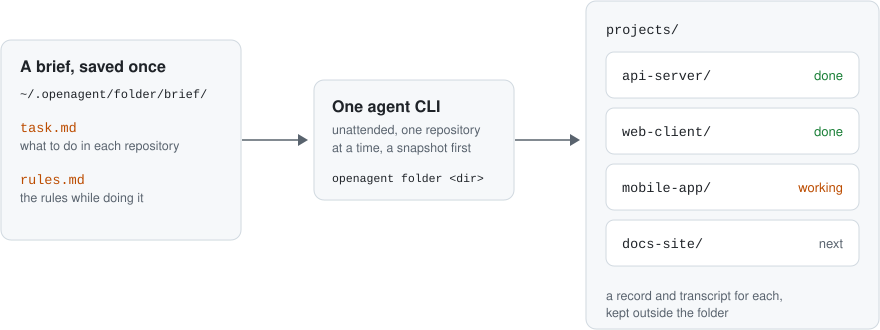

# OpenAgent

**和 AI 编程 agent 一起做长项目。**

[](https://github.com/wingsofsky/OpenAgent/actions/workflows/ci.yml)

本仓库把长项目的上下文写进一套完整的文档，不绑定特定账号、agent 或环境。文档就是契约：每个 agent 会话开工前都读它，按同一套规则干活，所以换账号、换 agent、换机器都能从上一个会话停下的地方接着做。仓库包含 context、sessions、delegate、folder 四个模块。各模块分开安装，按需选择，只下载选中的部分。

仓库里还记着一个维护者用 AI agent 做长项目踩过的坑：契约怎么保持短，什么算做完，审查要换新会话或别家模型，派子 agent 时别把自己的倾向写进任务书，哪些子 agent 能并行，无头 agent 的任务书怎么写、交回来的东西怎么核。详见[和 AI agent 一起干活](modules/context/zh-CN/openagent-context/references/working-with-ai-agents.md)和[委派经验](modules/delegate/skills/openagent-delegate/references/delegation-practices.md)（英文）。

[English](README.md)

## 每个模块解决什么

新开的 agent 会话只知道它读到的文件。长项目因此会遇到四个问题，每个模块解决其中一个：

| 问题 | 模块 |
|---|---|
| 新会话、新账号忘了之前定下的规则和决定；计划、报告东一份西一份，找不回来 | context |
| 三周前定的事留在某次对话里，已经翻不到了 | sessions |
| 付费用了几家 agent，各有所长，却从来没在同一件事上配合过 | delegate |
| 一整个文件夹的仓库要做同一类活，没人盯着 | folder |

已经有 `AGENTS.md` 和决策日志的项目，照样能用 context 做体检：它会看文档放在哪、契约、决策日志和提交规范，要搬要改都等你点头。

## 用起来是什么样

**context**：你的习惯、项目的规则、决策和文档，各放进每个会话一开工就读的文件里。


**sessions**：六个 agent CLI 的历史对话，变成能搜的 Markdown。



**delegate**：主 agent 把任务交给别家 agent CLI，留下记录，自己核对结果。一次真实委派在 Claude Code 里的样子，见 [delegate 的 README](modules/delegate/README.md)（英文）。



**folder**：一个 agent CLI 按一份只写一次的任务书，挨个处理文件夹里的仓库。



（图里的文字是英文。）

## 模块

| 模块 | 你会得到 | 需要 |
|---|---|---|
| [context](modules/context/README.zh-CN.md) | `docs/` 下给计划、报告、调研、指南定好的位置和找旧文档的办法；项目 `CLAUDE.md` / `AGENTS.md` 的模板，以及每个项目都用的个人习惯模板；ADR（架构决策记录）格式的决策日志，每条还写明谁拍的板；和 AI agent 一起干活踩过的坑。中文或英文 | git |
| [sessions](modules/sessions/README.md) | 你过去在 Claude Code、Codex、Gemini CLI、Grok Build、Antigravity、Cursor Agent 里的对话，不管来自哪个账号，都变成 `~/.openagent` 里能搜的 Markdown | Node 22.19+、pnpm、git |
| [delegate](modules/delegate/README.md) | 让每家 agent 做它最擅长的事：在聊天里让主 agent 把查资料交给 grok、算数交给 codex、多文件改代码交给 cursor、讲解和前端交给 agy。每个任务存成一个文件夹，有任务书、完整对话、改了什么和你的验收结论；执行者动项目之前先拍快照；一份共享手册记着每家 CLI 擅长什么 | Node 22.19+、pnpm、git，外加至少一个已登录的 agent CLI |
| [folder](modules/folder/README.md) | 一家 agent CLI 按你存好的任务书，无人值守地处理一整个文件夹的仓库；建在 delegate 之上 | 同 delegate |

所有模块在 Linux、macOS、Windows 三端都能用，CI 在三个系统上都跑测试。Windows 上的 `~/.openagent` 指 `%USERPROFILE%\.openagent`。OpenAgent 没有发布到 npm：有代码的模块用 Node 直接从下载的仓库里运行。

## 安装

把这句话发给你的主 agent：

```text
从 https://github.com/wingsofsky/OpenAgent 安装 OpenAgent 的 context 模块（中文版）：按仓库里的 INSTALL.md 做
```

要装更多模块，就把名字写上，比如「安装 context 和 sessions 模块」。agent 会先讲清各模块是什么，用稀疏克隆只下载你选的，查好本机已经装了什么，每一步改动你的机器之前都会先问。它从不问密码或 API key：每家 CLI 的登录在你的浏览器里打开，你自己登。每一步做什么，见 [INSTALL.md](INSTALL.md)。每个模块的 README 里也有手动安装的步骤。

## 模块之间的关系

```text
modules/context    一个 skill 加模板（没有代码）
modules/sessions   ┐
modules/delegate   ├─ 有代码，用同一个命令跑：node <repo>/packages/cli/src/cli.ts <命令>
modules/folder     ┘  （folder 需要 delegate）
packages/          共享代码：文件格式、路径检查、命令入口
```

这个命令只列出你检出了的模块的命令。记录和设置放在 `~/.openagent`（设 `OPENAGENT_HOME` 可以挪走）。OpenAgent 只在你要求时才往项目里写，也不从项目里读任何配置，所以你克隆下来的仓库改变不了委派跑什么。

## 安全

- context 模块只有文档，不在你的电脑上运行任何东西。
- 委派出去的 agent 以你的用户权限运行。agy、grok、cursor 和 claude 启动时跳过权限确认，因为无头运行的 CLI 没法回答确认，所以委派的任务能在你账号权限范围内的任何地方跑命令、写文件。它开工的文件夹只是起点，不是边界；只有 codex 保留自己的沙箱。执行者进你的项目干活之前，会先拍一份能恢复的快照。跳过确认可以按任务或按执行者关掉，见[默认权限](modules/delegate/README.md#default-permissions)。
- 请求里来的路径（项目文件、任务 id、快照路径）都经过同一个检查模块。
- 每个项目的主 agent 都能读手册和导入的对话。别把 `~/.openagent` 放进公开同步的文件夹。

详见 [SECURITY.md](SECURITY.md)。

## 文档

- [INSTALL.md](INSTALL.md)：安装时 agent 按模块做了什么
- 各模块的 README：[context](modules/context/README.zh-CN.md)、[sessions](modules/sessions/README.md)、[delegate](modules/delegate/README.md)（全部委派命令和 MCP 工具）、[folder](modules/folder/README.md)
- [和 AI agent 一起干活](modules/context/zh-CN/openagent-context/references/working-with-ai-agents.md)、[委派经验](modules/delegate/skills/openagent-delegate/references/delegation-practices.md)（英文）：长项目里踩过的坑，和现在的做法
- [这个仓库是怎么做出来的](docs/design/how-this-repository-is-built.md)：让 agent 写的代码说实话的那些检查

## 许可证

[Apache-2.0](LICENSE)
