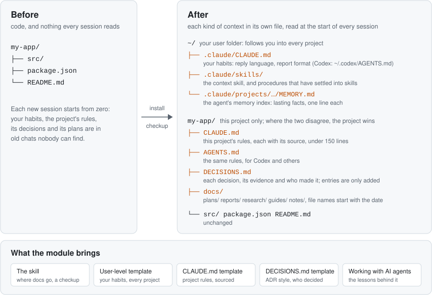

# Longkeep context

This module keeps a project's context in documents that every agent session reads. It contains one skill and templates for the files that hold that context. It has no code: downloading it needs only git, and any agent that reads skills can use it (Claude Code, Codex and others).



[中文说明](README.zh-CN.md)

What you get:

- Fixed places under `docs/` for plans, reports, research and guides, and a way to find earlier ones, so every session files and finds documents the same way.
- A contract template for `CLAUDE.md` / `AGENTS.md`: the rules every session reads first, each with its source, under 150 lines.
- A template for your own habits, the user-level `~/.claude/CLAUDE.md` / `~/.codex/AGENTS.md` that applies in every project: reply language, report format, what to ask you first.
- A decision log template for `DECISIONS.md` in the ADR (architecture decision record) style: each design choice with its evidence and who made it.
- A checkup for an existing project: where its documents are, its contract, its decision log and commit conventions; then, if the user wants, documents moved under `docs/` and a guided rewrite of the contract from past conversations. Nothing is written before the user approves.
- Lessons from working with AI agents: where the rules in the templates came from, plus review, context isolation, parallel subagents, reasoning effort and where personal habits go.

The skill comes in English and Chinese. The language of the skill is the language your agent tends to answer in, so pick the one you want replies in.

| Language | Skill folder |
|---|---|
| English | [en/longkeep-context](en/longkeep-context/SKILL.md) |
| Chinese | [zh-CN/longkeep-context](zh-CN/longkeep-context/SKILL.md) |

Each folder holds `SKILL.md` and `references/`: [contract template](en/longkeep-context/references/contract-template.md), [user-level template](en/longkeep-context/references/user-template.md), [decision log template](en/longkeep-context/references/decision-log-template.md), [working with AI agents](en/longkeep-context/references/working-with-ai-agents.md).

## Install

Send this to your main agent:

```text
Install the context module of Longkeep from https://github.com/wingsofsky/longkeep: follow INSTALL.md in that repository
```

By hand, download only this module:

```bash
git clone --filter=blob:none --sparse https://github.com/wingsofsky/longkeep.git <repo>
cd <repo> && git sparse-checkout set modules/context
```

Then copy the skill of your language (`en` or `zh-CN`) where your agent reads skills. For one project:

```bash
mkdir -p <project>/.claude/skills
cp -r <repo>/modules/context/en/longkeep-context <project>/.claude/skills/
```

For every project, copy it to `~/.claude/skills/` instead. Codex reads the same folder from `<project>/.agents/skills/`. Copying does not follow updates: after `git pull`, copy again. Restart the agent session afterwards.

## Using it

The skill tells agents where to put plans, reports and notes, so the next session finds them:

```
docs/
  plans/      2026-10-26-search-redesign.md     plans, designs
  reports/    2026-10-26-release-check.md       work reports, post-mortems
  research/   2026-10-20-vector-db-compare.md   research, comparisons
  guides/     2026-09-30-local-setup.md         how-tos
  notes/                                        anything else
```

Each file name starts with its date, and an agent updates an existing document before it starts a new one. Three more files hold what every session needs:

| File | Holds |
|---|---|
| `CLAUDE.md` / `AGENTS.md` | rules every session follows, each with its source, under 150 lines |
| `DECISIONS.md` | each design choice with its evidence and who made it; entries are only ever added |
| `MEMORY.md` | the agent's index of lasting facts: your preferences, machine quirks, where things are |

Progress goes in `docs/plans/`, never in these three.

Nothing to run. The agent loads the skill when it writes or looks for a document, or when you ask it to set up `CLAUDE.md` or a decision log. It shows you a draft before it writes your contract.

## License

[Apache-2.0](../../LICENSE)
